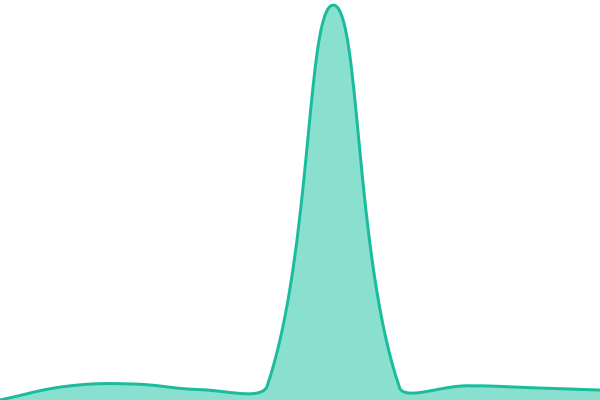

# [📈 Stato in tempo reale](https://status.officinatecnologica.eu): <!--live status--> **Tutti i servizi sono operativi**

This repository contains the open-source uptime monitor and status page for [Dhareck](https://status.officinatecnologica.eu), powered by [Upptime](https://github.com/upptime/upptime).

With [Upptime](https://upptime.js.org), you can get your own unlimited and free uptime monitor and status page, powered entirely by a GitHub repository. We use [Issues](https://github.com/Dhareck/status-officina/issues) as incident reports, [Actions](https://github.com/Dhareck/status-officina/actions) as uptime monitors, and [Pages](https://status.officinatecnologica.eu) for the status page.

## [📈 Live Status](https://demo.upptime.js.org): <!--live status--> **Tutti i servizi sono operativi**

<!--start: status pages-->
<!-- This summary is generated by Upptime (https://github.com/upptime/upptime) -->
<!-- Do not edit this manually, your changes will be overwritten -->
<!-- prettier-ignore -->
| URL | Stato | Cronologia | Tempo di risposta | Disponibilità |
| --- | ------ | ------- | ------------- | ------ |
|  [Sito dell'officina](https://officinatecnologica.eu) | Operativo | [sito.yml](https://github.com/Dhareck/status-officina/commits/HEAD/history/sito.yml) | 

 789ms
     
 | 

<a href="https://status.officinatecnologica.eu/history/sito">100.00%</a>
    

|  [Forgejo](https://git.officinatecnologica.eu/api/healthz) | Operativo | [forgejo.yml](https://github.com/Dhareck/status-officina/commits/HEAD/history/forgejo.yml) | 

 506ms
     
 | 

<a href="https://status.officinatecnologica.eu/history/forgejo">100.00%</a>
    

|  [Chat Matrix](https://matrix.officinatecnologica.eu/_matrix/client/versions) | Operativo | [matrix.yml](https://github.com/Dhareck/status-officina/commits/HEAD/history/matrix.yml) | 

 484ms
     
 | 

<a href="https://status.officinatecnologica.eu/history/matrix">100.00%</a>
    

|  [BananaWiki](https://officina.bananawiki.com/login) | Operativo | [bananawiki.yml](https://github.com/Dhareck/status-officina/commits/HEAD/history/bananawiki.yml) | 

 739ms
     
 | 

<a href="https://status.officinatecnologica.eu/history/bananawiki">100.00%</a>
    

|  [BananaWiki Hosting Platform](https://hosting.bananawiki.com/login) | Operativo | [hosting.yml](https://github.com/Dhareck/status-officina/commits/HEAD/history/hosting.yml) | 

 549ms
     
 | 

<a href="https://status.officinatecnologica.eu/history/hosting">97.63%</a>
    

|  [BananaChat](https://chat.bananawiki.com/login) | Operativo | [bananachat.yml](https://github.com/Dhareck/status-officina/commits/HEAD/history/bananachat.yml) | 

 662ms
     
 | 

<a href="https://status.officinatecnologica.eu/history/bananachat">100.00%</a>
    

<!--end: status pages-->

[**Visit our status website →**](https://status.officinatecnologica.eu)

## 📄 License

- Powered by: [Upptime](https://github.com/upptime/upptime)
- Code: [MIT](./LICENSE) © [Anand Chowdhary](https://anandchowdhary.com)
- Data in the `./history` directory: [Open Database License](https://opendatacommons.org/licenses/odbl/1-0/)
